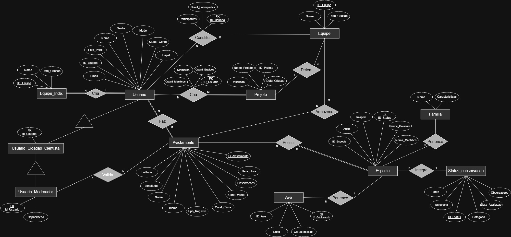

<h1 align="center">🐦 Mantuí: Banco de Dados 💾</h1>

O Mantuí é um projeto de pesquisa direcionado para o desenvolvimento de uma plataforma web offline-first, voltada à conservação de aves brasileiras.
<br>
Este repositório foi criado para o desenvolvimento do banco de dados e da camada do sistema Mantuí baseada nos conceitos de modelagem UML. A partir dos diagramas de entidade-relacionamento (DER) e de classes, foram implementadas as entidades, funções e rotas que estruturam esta etapa do projeto.


## 📈 Diagrama Entidade Relacionamento
<p align="center">
  
</p>

### Entidades
```bash
Usuario
Equipe
Avistamento
Projeto
Ave
Especie
Familia
StatusConservacao
```
