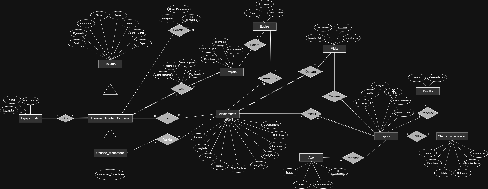

# Mantuí 🐦

> O Mantuí é um sistema web offline-first criado para apoiar o monitoramento e a conservação de aves limícolas migratórias no litoral do Rio Grande do Norte. A plataforma permite registrar avistamentos com geolocalização, organizar dados de campo, gerar relatórios e auxiliar no gerenciamento de equipes, mesmo em áreas com acesso limitado ou inexistente à internet.

> O projeto foi pensado para atender às necessidades de pesquisadores envolvidos em ações de conservação, especialmente diante dos desafios do monitoramento em regiões remotas e da importância ecológica dessas aves para a biodiversidade. Sua proposta está conectada ao contexto do Flyways Brasil, iniciativa da SAVE Brasil voltada à conservação de aves limícolas e seus habitats na Bacia Potiguar.

---

## 📌 Sobre o Projeto
Contexto do Frontend:
- **Linguagens de marcação e estilo Utilizadas:** HTML5, CSS
- **Framework Utilizado:** TailwindCSS
- **Versão:** 4.3.3
- **Bibliotecas:** anime.js
  
Contexto do Backend:
- **Linguagens de programação Utilizadas:** Python, JavaScript
- **Framework Utilizado:** Flask
- **Versão:** 3.1.x
- **Bibliotecas:** Flask-Migrate, Flask-Script, Flask-SQLAlchemy, Jinja2, PyMySQL, python-dotenv, utils

Contexto do banco de dados:
- **Biblioteca Utilizada:** SQLAlchemy
- **Versão:** 2.0.52
- **Modelagem:** Relacional (DER)

---

## 🗂️ Estrutura do Repositório
```text
├── 📂 controllers/       # organiza o fluxo de dados e resposta pro Usuário
|   ├── Ave.py
│   ├── Avistamento.py
│   ├── Equipe.py 
│   ├── Especie.py 
│   ├── Projeto.py      
│   └── Usuario.py 
|      
├── 📂 migrations/        # Rastrear Histórico de alteração do Banco de Dados
|
├── 📂 static/            # Armazenar arquivos que não mudam
│   └── 📂 img/           # Armazenar imagens
│        ├── Diagrama-Entidade-Relacionamento.png
│        └── Diagrama-de-Classes.png 
│   
├── 📂 templates/         # Guarda os arquivos HTML
│   ├── ave_add.html
│   ├── ave_recovery.html 
│   ├── ave_update.html
|   | 
│   ├── avistamento_add.html
│   ├── avistamento_recovery.html 
│   ├── avistamento_update.html
|   | 
│   ├── equipe_add.html      
│   ├── equipe_recovery.html 
│   ├── equipe_update.html 
|   | 
│   ├── especie_add.html      
│   ├── especie_recovery.html
│   ├── especie_update.html
|   | 
│   ├── index.html 
|   | 
│   ├── projeto_add.html      
│   ├── projeto_recovery.html
│   ├── projeto_update.html
|   | 
│   ├── usuario_add.html      
│   ├── usuario_recovery.html
│   └── usuario_update.html
├── .gitignore              # Indicar ao Git quais arquivos e pastas não devem ser rastreados
├── README.md               # apresentar e explicar o projeto
├── requirements.txt        # Listar todas os pacotes externos que o projeto precisa para funcionar
└── utils.py                # armazenar funções de ajuda reutilizáveis e genéricas
```

---

## 📊 Modelo Entidade-Relacionamento (DER)
<p align="center">
  
</p>

---

## 📝 Sobre as Classes do sistema
Breve resumo das principais classes:

| Classe | Descrição |
| :--- | :--- |
| `Usuario` | Armazena informações de cadastro. |
| `CidadaoCientista(Usuario)` | Realiza os Avistamentos das Aves. |
| `Moderador(CidadaoCientista)` | Valida os avistamentos. |
| `SolicitacaoModerador` | CidadaoCientista solicita a permição para moderar. |
| `MembroEquipe` | Representa a participação de um usuário em uma equipe. |
| `Equipe` | Grupo de Usuários (ou um usuário individual) para realizar e armazenar os avistamentos. |
| `Projeto` | Junção de equipes e usários. |
| `Avistamento` | Coleta as informações observadas de determinada(s) Ave(s). |
| `Ave` | Determinado Animal observado isoladamente. |
| `Especie` | Grupo no qual as aves pertencem. |
| `Familia` | Grupo no qual as espécies pertencem. |
| `StatusConservacao` | Estatísticas sobre a conservação das espécies de aves, com base nos avistamentos. |
| `Midia` | Estrutura os arquivos presentes nos avistamentos (os registros) e complementa o StatusConservacao. |
| `GeradorGrafico` | Cria rGráficos com base nos dados dos avistamentos. |
| `MapaInterativo` | Representação visual dos dados coletados e construidos sobre as espécies. |

---
